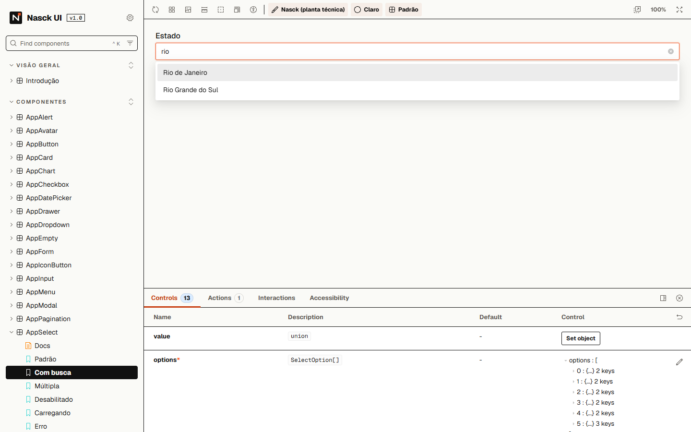
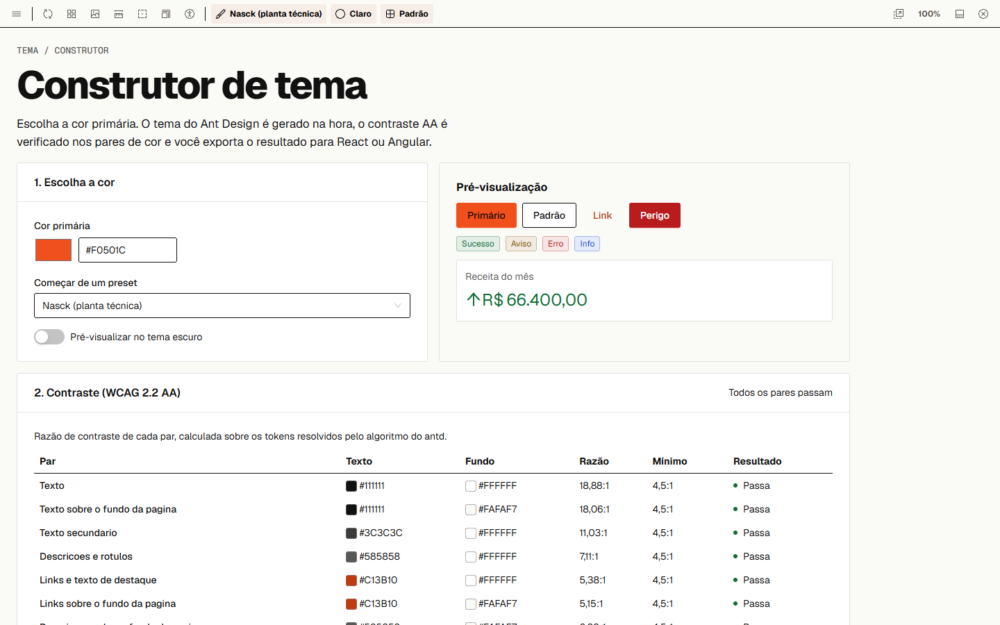
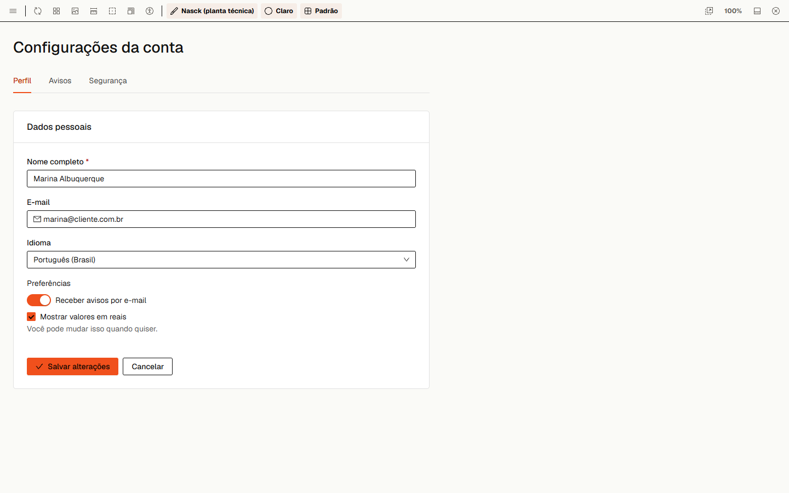
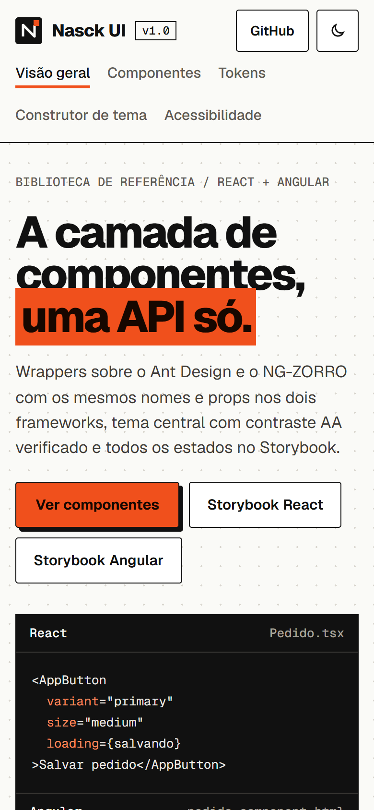
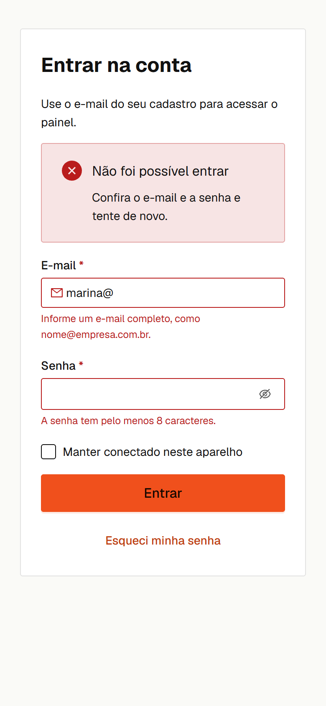
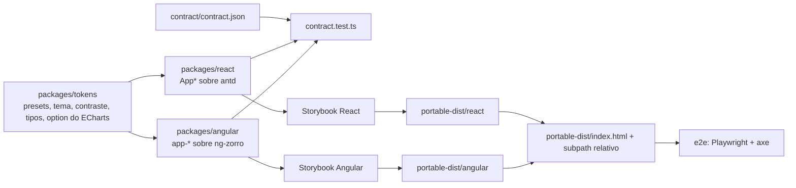

# Nasck UI · wrappers de referência sobre Ant Design e NG-ZORRO

[](https://github.com/NasckDev/nasck-ui/actions/workflows/ci.yml)
[](./LICENSE)


Camada de componentes **`App*`** sobre o **Ant Design** (React) e o **NG-ZORRO** (Angular), com os
**mesmos nomes e as mesmas props nos dois frameworks**, tema central com contraste AA verificado,
gráficos em ECharts e **Storybook React e Storybook Angular** com todos os estados.

É a referência do padrão de UI dos projetos InsightHub, FiscoTrack e OpsFlow: a tabela de
[contrato](#contrato-de-componentes) abaixo é o que cada app segue no próprio `src/ui/`.

**Demo ao vivo:** <https://nasckdev.github.io/nasck-ui/> · também embutida no portfólio, em
`/projetos/nasck-ui/` (a entrada linka `react/` e `angular/`, os dois Storybooks buildados).

**Identidade "planta técnica"** ([ADR 0005](./docs/adr/0005-identidade-planta-tecnica.md)): grade
pontilhada, linhas de 1 px em grafite, cantos de 3 px, Geist na interface e Geist Mono em código e
rótulos. O laranja `#F0501C` é a assinatura e sempre leva texto `#160700` por cima, nunca branco.
Os espécimes da página de entrada são os wrappers React de verdade, com o preset `nasck`.


| AppButton no Storybook React                                     | AppSelect com busca                                                   |
| ---------------------------------------------------------------- | --------------------------------------------------------------------- |
|         |  |
| **Construtor de tema**                                           | **Tokens no tema escuro**                                             |
|  |           |
| **Painel: AppTable e AppChart (React)**                          | **Configurações no Storybook Angular**                                |
|                |       |

| Celular: entrada                                            | Celular: menu do Storybook                        | Celular: painel composto                                        | Celular: login com erro                                    |
| ----------------------------------------------------------- | ------------------------------------------------- | --------------------------------------------------------------- | ---------------------------------------------------------- |
|  |  |  |  |

## Por que wrappers

- **Telas nunca tocam a biblioteca.** O app usa só `AppButton`, `AppTable` e companhia. Atualizar ou
  trocar o Ant Design vira uma mudança em um lugar. Uma regra de lint (`no-restricted-imports`) barra
  `antd`, `ng-zorro-antd` e `echarts` fora de `src/ui/`.
- **A mesma API nos dois frameworks.** Quem conhece `<AppButton variant="primary" loading>` no React
  escreve `<app-button variant="primary" [loading]="true">` no Angular. Um teste lê o código dos dois
  pacotes e falha se um nome divergir do contrato.
- **Tema central.** Cores, raios e fontes vêm de tokens do antd gerados a partir de um preset de
  paleta. Nada de cor ou px fixo nos componentes.
- **Acessibilidade medida.** Axe com zero violações em todas as stories, nos dois Storybooks, nos
  modos claro e escuro.

## Estrutura



| Pacote             | O que tem                                                                                                                           |
| ------------------ | ----------------------------------------------------------------------------------------------------------------------------------- |
| `packages/tokens`  | Presets de paleta, `buildTheme`, contraste AA (`checkTheme`), variáveis CSS para o NG-ZORRO, tipos do contrato, `buildChartOption`. |
| `packages/react`   | Wrappers `App*` em `src/ui/`, stories ao lado de cada componente, modelos (painel, login), construtor de tema, testes com Vitest.   |
| `packages/angular` | Wrappers standalone `app-*` em `src/ui/`, stories, modelos (painel, configurações), testes com o runner do Angular (`ng test`).     |
| `contract/`        | `contract.json` (a fonte do contrato) e `contract.test.ts` (compara React e Angular com ele).                                       |
| `e2e/`             | Playwright com axe: todas as stories dos dois Storybooks e a página de entrada em 390 e 1440 px, claro e escuro, em dois subpaths.  |
| `portable-src/`    | Página de entrada da demo (HTML buildado pelo Vite) e `specimens.tsx`, que monta os wrappers React reais nos espécimes.             |
| `scripts/`         | `build-portable.mjs` (monta `portable-dist/`), `portable-stats.ts` (números da entrada), `serve.mjs` e `capture-prints.mjs`.        |

## Contrato de componentes

Esta tabela é gerada de `contract/contract.json`. **Mesmos nomes de props no React e de inputs no
Angular.** Eventos mudam só de convenção: `onX` no React, output em português ou `xChange` no Angular.
Conteúdo projetado (`children` no React, `<ng-content>` no Angular) não entra na tabela.

| Componente         | Angular                | Props (React) e inputs (Angular)                                                                                                                       | Eventos: React → Angular                            |
| ------------------ | ---------------------- | ------------------------------------------------------------------------------------------------------------------------------------------------------ | --------------------------------------------------- |
| `AppThemeProvider` | `<app-theme-provider>` | `preset`, `mode`, `density`                                                                                                                            | —                                                   |
| `AppButton`        | `<app-button>`         | `variant`, `size`, `loading`, `disabled`, `icon`, `danger`, `block`, `htmlType`                                                                        | `onClick` → `clicked`                               |
| `AppIconButton`    | `<app-icon-button>`    | `icon`, `label`, `variant`, `size`, `loading`, `disabled`, `danger`                                                                                    | `onClick` → `clicked`                               |
| `AppInput`         | `<app-input>`          | `value`, `type`, `label`, `placeholder`, `hint`, `errorMessage`, `size`, `disabled`, `loading`, `allowClear`, `prefixIcon`, `required`                 | `onChange` → `valueChange`                          |
| `AppSelect`        | `<app-select>`         | `value`, `options`, `placeholder`, `label`, `hint`, `errorMessage`, `size`, `disabled`, `loading`, `searchable`, `multiple`, `allowClear`, `emptyText` | `onChange` → `valueChange`, `onSearch` → `searched` |
| `AppCheckbox`      | `<app-checkbox>`       | `checked`, `label`, `disabled`, `indeterminate`, `errorMessage`                                                                                        | `onChange` → `checkedChange`                        |
| `AppSwitch`        | `<app-switch>`         | `checked`, `label`, `disabled`, `loading`, `size`                                                                                                      | `onChange` → `checkedChange`                        |
| `AppDatePicker`    | `<app-date-picker>`    | `value`, `label`, `placeholder`, `hint`, `errorMessage`, `size`, `disabled`, `allowClear`                                                              | `onChange` → `valueChange`                          |
| `AppForm`          | `<app-form>`           | `layout`, `disabled`, `size`                                                                                                                           | `onSubmit` → `submitted`                            |
| `AppFormItem`      | `<app-form-item>`      | `label`, `hint`, `errorMessage`, `required`                                                                                                            | —                                                   |
| `AppTable`         | `<app-table>`          | `columns`, `data`, `rowKey`, `loading`, `emptyText`, `pageSize`, `pagination`, `size`                                                                  | `onRowClick` → `rowClick`                           |
| `AppCard`          | `<app-card>`           | `title`, `extra`, `loading`, `bordered`, `hoverable`, `size`                                                                                           | —                                                   |
| `AppStatistic`     | `<app-statistic>`      | `title`, `value`, `prefix`, `suffix`, `precision`, `loading`, `trend`                                                                                  | —                                                   |
| `AppTag`           | `<app-tag>`            | `label`, `color`, `icon`, `closable`, `bordered`                                                                                                       | `onClose` → `closed`                                |
| `AppStatus`        | `<app-status>`         | `status`, `label`                                                                                                                                      | —                                                   |
| `AppModal`         | `<app-modal>`          | `open`, `title`, `okText`, `cancelText`, `loading`, `danger`, `width`, `closable`                                                                      | `onOk` → `confirmed`, `onCancel` → `cancelled`      |
| `AppDrawer`        | `<app-drawer>`         | `open`, `title`, `placement`, `width`, `closable`                                                                                                      | `onClose` → `closed`                                |
| `AppTabs`          | `<app-tabs>`           | `items`, `activeKey`, `type`, `size`                                                                                                                   | `onChange` → `activeKeyChange`                      |
| `AppSteps`         | `<app-steps>`          | `items`, `current`, `direction`, `size`                                                                                                                | —                                                   |
| `AppEmpty`         | `<app-empty>`          | `title`, `description`, `actionLabel`, `image`                                                                                                         | `onAction` → `action`                               |
| `AppSkeleton`      | `<app-skeleton>`       | `loading`, `rows`, `avatar`, `title`, `active`                                                                                                         | —                                                   |
| `AppAlert`         | `<app-alert>`          | `type`, `title`, `description`, `closable`, `showIcon`, `banner`                                                                                       | `onClose` → `closed`                                |
| `AppTooltip`       | `<app-tooltip>`        | `title`, `placement`                                                                                                                                   | —                                                   |
| `AppDropdown`      | `<app-dropdown>`       | `items`, `label`, `trigger`, `placement`, `disabled`, `icon`                                                                                           | `onSelect` → `selected`                             |
| `AppMenu`          | `<app-menu>`           | `items`, `selectedKey`, `mode`, `collapsed`                                                                                                            | `onSelect` → `selected`                             |
| `AppAvatar`        | `<app-avatar>`         | `src`, `name`, `size`, `shape`, `icon`                                                                                                                 | —                                                   |
| `AppPagination`    | `<app-pagination>`     | `current`, `total`, `pageSize`, `showSizeChanger`, `simple`, `disabled`                                                                                | `onChange` → `pageChange`                           |
| `AppChart`         | `<app-chart>`          | `type`, `categories`, `series`, `title`, `height`, `loading`, `emptyText`, `ariaLabel`, `valueFormat`                                                  | —                                                   |

### Valores e formatos compartilhados

Os tipos vivem em `@nasckdev/nasck-ui-tokens` (`packages/tokens/src/models.ts`) e são idênticos nos dois frameworks.

| Prop                                        | Valores                                                                                                                                                                                                           |
| ------------------------------------------- | ----------------------------------------------------------------------------------------------------------------------------------------------------------------------------------------------------------------- |
| `size` (botões, campos, tabela, formulário) | `small`, `medium`, `large` (`AppSwitch`, `AppSteps`, `AppAvatar`: ver stories)                                                                                                                                    |
| `variant` (botões)                          | `primary`, `default`, `dashed`, `text`, `link`                                                                                                                                                                    |
| `icon`, `prefixIcon`                        | `plus`, `search`, `delete`, `edit`, `download`, `upload`, `check`, `close`, `user`, `setting`, `bell`, `info`, `warning`, `mail`, `calendar`, `filter`, `reload`, `more`, `arrow-up`, `arrow-down`, `home`, `eye` |
| `AppSelect.options`                         | `{ value, label, disabled? }[]`                                                                                                                                                                                   |
| `AppTable.columns`                          | `{ key, title, sortable?, align?, width?, format? }[]` com `format`: `text`, `number`, `currency`, `date`                                                                                                         |
| `AppTable.data`                             | `Record<string, string \| number \| null>[]` (a coluna lê `row[key]`)                                                                                                                                             |
| `AppTabs.items`                             | `{ key, label, disabled?, content? }[]`                                                                                                                                                                           |
| `AppSteps.items`                            | `{ title, description?, status? }[]`                                                                                                                                                                              |
| `AppDropdown.items`, `AppMenu.items`        | `{ key, label, icon?, disabled?, danger? }[]`                                                                                                                                                                     |
| `AppChart`                                  | `type`: `line`, `area`, `bar`, `pie`; `series`: `{ name, data: number[] }[]`; `valueFormat`: `number`, `currency`, `percent`                                                                                      |
| `AppDatePicker.value`                       | texto ISO `AAAA-MM-DD` (ou `null`)                                                                                                                                                                                |
| `AppPagination` (evento)                    | React: `onChange(page, pageSize)`. Angular: `pageChange` com `{ page, pageSize }`                                                                                                                                 |

## Como usar

Os apps **não instalam** este pacote (instalar via GitHub é lento). Cada app tem o próprio `src/ui/`
seguindo o contrato desta página, com os wrappers dele sobre `antd` ou `ng-zorro-antd`. Este
repositório é a referência e o lugar onde o contrato muda primeiro.

### React

```bash
npm install antd @ant-design/icons dayjs echarts echarts-for-react
npm install @fontsource-variable/space-grotesk @fontsource-variable/dm-sans @fontsource/space-mono
```

```tsx
import { AppButton, AppInput, AppThemeProvider } from './ui';

export function App() {
  return (
    <AppThemeProvider preset="insighthub" mode="light">
      <AppInput label="E-mail" type="email" errorMessage="Informe um e-mail completo." />
      <AppButton variant="primary" icon="plus" onClick={() => undefined}>
        Novo cliente
      </AppButton>
    </AppThemeProvider>
  );
}
```

`AppThemeProvider` monta o `ConfigProvider theme={{ token, components, algorithm }}` do antd a partir de
`buildTheme(preset, { mode, density })`.

### Angular

```bash
npm install ng-zorro-antd ngx-echarts echarts @ant-design/icons-angular
```

```ts
// app.config.ts
import { provideNasckUi } from './ui/providers';

export const appConfig = { providers: [provideNasckUi()] };
```

```html
<app-theme-provider preset="opsflow" mode="dark">
  <app-input label="E-mail" type="email" [(value)]="email" />
  <app-button variant="primary" icon="plus" (clicked)="create()">Novo cliente</app-button>
</app-theme-provider>
```

Em `angular.json`, carregue o CSS variável do NG-ZORRO e o `nasck-overrides.css`:
`node_modules/ng-zorro-antd/ng-zorro-antd.variable.min.css` e `src/styles/nasck-overrides.css`.

### Tema e presets

Presets prontos: `nasck` (planta técnica: grafite, papel e laranja `#F0501C` com texto `#160700`, raio de 3 px), `insighthub` (petróleo `#0F766E`),
`fiscotrack` (verde-floresta `#0E3B2E`) e `opsflow` (azul `#2F6BFF`). Cada um tem modo claro e escuro e
densidade padrão ou compacta.

- **React:** `ConfigProvider theme` com `token`, `components` e o algoritmo do antd (`darkAlgorithm`,
  `compactAlgorithm`).
- **Angular:** `NasckThemeService.apply(preset, mode)` grava as variáveis CSS do NG-ZORRO
  (`--ant-primary-*`, `--ant-error-color`...) e os tokens `--ant-color-*` no `<html>`.
- **Construtor de tema:** no Storybook React, `Tema / Construtor de tema`. Escolha a cor primária, veja
  os tokens do antd gerados, confira o contraste AA de cada par e exporte em TypeScript (antd), CSS
  (NG-ZORRO) ou JSON.

Texto sobre a cor primária é calculado (preto ou branco, o que tiver mais contraste), a não ser que o preset
defina o próprio (`onPrimary`, como o `#160700` do `nasck`) e ele passe AA. Se nenhum dos dois
chega a 4,5:1, a primária é ajustada o mínimo necessário (acontece com o azul `#2F6BFF`).

## Storybook

```bash
npm install
npm run storybook:react      # http://localhost:6006
npm run storybook:angular    # http://localhost:6007
```

Cada componente tem as stories **Padrão, Desabilitado, Carregando, Erro e Vazio** quando fazem sentido,
com controles nas props mais usadas. Na barra de ferramentas: **preset de tema**, **modo claro/escuro** e
**densidade**. O addon `@storybook/addon-a11y` roda o axe em cada story (`a11y.test = 'error'`).

## Desenvolvimento e entrega

```bash
npm run lint && npm run typecheck
npm run test                 # tokens, React, contrato e Angular
npm run build-storybook      # os dois Storybooks
npm run dev:portable         # página de entrada em http://localhost:5195 (números de stories após o build-storybook)
npm run build:portable       # portable-dist/ (entrada + react/ + angular/)
node scripts/serve.mjs 4173  # serve em /projetos/nasck-ui/ e /Myportfolio/projetos/nasck-ui/
npm run test:e2e             # Playwright + axe (usa portable-dist)
```

- No Windows, para usar o Chrome instalado no E2E: `PW_CHANNEL=chrome npm run test:e2e`.
- Se a porta 4173 estiver ocupada, use outra: `E2E_PORT=5195 npm run test:e2e`.
- O E2E aceita `A11Y_FRAMEWORKS`, `A11Y_MODES`, `A11Y_PRESETS` e `A11Y_FILTER` (axe) e `LAYOUT_FRAMEWORKS` e
  `LAYOUT_FILTER` (larguras) para rodar um recorte.
- Vitest roda com `--pool=threads --maxWorkers=1` (já nos scripts).
- **CI** (`.github/workflows/ci.yml`): lint, formatação, typecheck, testes, `build-storybook` dos dois,
  `build:portable` e E2E com axe. **Pages** (`pages.yml`) publica `portable-dist/`.

## Decisões e limites conhecidos

Decisões em [`docs/adr/`](./docs/adr). O código antigo (componentes próprios e site de documentação) saiu
do produto e está na tag `v0.2.0-legacy`.

- **O NG-ZORRO 22 não tem o visual do antd 6.** O CSS dele ainda é o do estilo antd v4 e só lê variáveis
  para a paleta primária e as semânticas. O pacote Angular traz `nasck-overrides.css`, que repinta
  texto, fundos, bordas, raio e fonte com os tokens do tema. Fica parecido, mas não idêntico.
- **`AppTabs`:** o conteúdo vai em `items[].content` (texto) ou no conteúdo projetado abaixo das abas,
  trocado pelo app ao ouvir a mudança de `activeKey`.
- **`loading` em botões:** a prop `loading` do antd e do NG-ZORRO cobre o botão com uma camada translúcida
  e derruba o contraste abaixo de AA. Os wrappers mostram o ícone giratório com `aria-busy` e ignoram o
  clique.
- **`AppTable` e linhas clicáveis:** as linhas só recebem foco e Enter quando alguém escuta `onRowClick` /
  `rowClick`.
- **O E2E com axe roda com o preset `nasck`** (claro e escuro). Os outros três presets são cobertos
  pelos testes de contraste (18 pares, claro e escuro), não por axe nas stories; para rodar o axe com
  outro preset use `A11Y_PRESETS=opsflow npm run test:e2e`.
- **O construtor de tema existe só no Storybook React.** O Angular recebe o resultado exportado em CSS.
- **Pacotes não publicados.** Os apps copiam o contrato; não há publicação no npm.

## Dependências e licenças

Tudo em versão exata. Só licenças abertas (MIT ou Apache 2.0) em produção. Exceções documentadas:
as fontes (OFL-1.1, a licença das próprias famílias), `tslib` (0BSD, permissiva) e `axe-core`
(MPL-2.0) usados só em desenvolvimento e testes, sem ir para o build.

| Pacote                                   | Versão                   | Licença    | Uso                                     |
| ---------------------------------------- | ------------------------ | ---------- | --------------------------------------- |
| antd                                     | 6.7.1                    | MIT        | React: componentes e tema               |
| @ant-design/icons                        | 6.3.4                    | MIT        | React: ícones                           |
| dayjs                                    | 1.11.23                  | MIT        | React: datas do antd                    |
| echarts                                  | 6.1.0                    | Apache-2.0 | gráficos (só `echarts/core` registrado) |
| echarts-for-react                        | 3.1.0                    | MIT        | React: ECharts                          |
| react / react-dom                        | 19.3.1                   | MIT        | React                                   |
| ng-zorro-antd                            | 22.2.0                   | MIT        | Angular: componentes                    |
| @ant-design/icons-angular                | 22.1.1                   | MIT        | Angular: ícones                         |
| ngx-echarts                              | 22.0.0                   | MIT        | Angular: ECharts                        |
| @angular/core (e demais pacotes Angular) | 22.3.0                   | MIT        | Angular                                 |
| rxjs                                     | 7.8.2                    | Apache-2.0 | Angular                                 |
| zone.js                                  | 0.16.3                   | MIT        | Angular (Storybook)                     |
| storybook (e addons a11y e docs)         | 10.6.8                   | MIT        | Storybook React e Angular               |
| vite / @vitejs/plugin-react              | 8.3.8 / 6.3.0            | MIT        | build e Storybook React                 |
| vitest / jsdom                           | 5.1.1 / 31.0.1           | MIT        | testes                                  |
| @testing-library/*                       | 10.4.2 a 16.3.3          | MIT        | testes React                            |
| @playwright/test                         | 1.65.1                   | Apache-2.0 | E2E                                     |
| @axe-core/playwright / axe-core          | 4.14.0 / 4.14.1          | MPL-2.0    | E2E e addon a11y (só desenvolvimento)   |
| typescript                               | 6.0.3                    | Apache-2.0 | tipos                                   |
| eslint / typescript-eslint / prettier    | 9.39.5 / 8.73.0 / 3.10.1 | MIT        | qualidade                               |
| @fontsource-variable (Geist, Geist Mono) | 5.3.0                    | OFL-1.1    | fontes auto-hospedadas                  |

`npm audit --omit=dev`: **0 vulnerabilidades**. O `npm audit` completo aponta 8 (5 moderadas, 3 altas) em
dependências transitivas das ferramentas do Storybook (`glob`, `minimatch`, `webpack-dev-middleware`),
só de desenvolvimento e sem correção sem quebrar o Storybook.

## Números reais

Medidos nesta máquina (Windows, lenta), com a versão atual do repositório.

| O que                          | Número                                                                                                                                                                                                                                                                                 |
| ------------------------------ | -------------------------------------------------------------------------------------------------------------------------------------------------------------------------------------------------------------------------------------------------------------------------------------- |
| Componentes no contrato        | **28** (27 componentes mais o `AppThemeProvider`), nos dois frameworks                                                                                                                                                                                                                 |
| Stories                        | **246**: 125 no Storybook React e 121 no Angular (mais 58 páginas de documentação automática)                                                                                                                                                                                          |
| Presets de paleta              | **4** (nasck, insighthub, fiscotrack, opsflow), cada um claro e escuro, padrão ou compacto                                                                                                                                                                                             |
| Pares de contraste verificados | **18** por preset e modo (8 combinações), todos passam AA, conferidos sobre os tokens resolvidos pelo antd                                                                                                                                                                             |
| Testes dos tokens              | **19** (Vitest)                                                                                                                                                                                                                                                                        |
| Testes dos wrappers React      | **60** (Vitest + Testing Library, `--pool=threads --maxWorkers=1`)                                                                                                                                                                                                                     |
| Testes dos wrappers Angular    | **25** (`ng test`, runner Vitest do Angular)                                                                                                                                                                                                                                           |
| Teste de contrato              | **142** verificações (5 por componente, mais os ícones): props, inputs, eventos, outputs e seletores                                                                                                                                                                                   |
| E2E (Playwright + axe)         | **25** testes: **0 violações** em 246 stories x 2 modos (492 renderizações) e na entrada em 390 e 1440 px; sem rolagem horizontal nem texto cortado na entrada e nas páginas de docs em 320, 375, 390, 768, 1024, 1280, 1440 e 1920 px (claro e escuro) e em todas as stories a 320 px |
| Subpaths testados              | `/projetos/nasck-ui/` e `/Myportfolio/projetos/nasck-ui/`, sem nenhum 404                                                                                                                                                                                                              |
| Código dos wrappers            | cerca de 2,3 mil linhas no React (`App*.tsx` e utilitários) e 1,5 mil no Angular (`*.component.ts`)                                                                                                                                                                                    |
| Demo (`portable-dist/`)        | 30 MB com os dois Storybooks, sem mapas de origem; a entrada carrega 530 KB de JS (169 KB com gzip) só para os espécimes reais                                                                                                                                                         |
| Instalação limpa               | 1168 pacotes, cerca de 10 minutos nesta máquina                                                                                                                                                                                                                                        |
| Duração do E2E completo        | cerca de 2 horas nesta máquina (a verificação de larguras abre cada story)                                                                                                                                                                                                             |
| `npm audit --omit=dev`         | 0 vulnerabilidades                                                                                                                                                                                                                                                                     |

No ECharts só o `echarts/core` é carregado, com os gráficos de linha, barra e pizza, os componentes de grade, tooltip, legenda, título e aria, e o renderizador canvas.

## Licença

MIT. Veja [LICENSE](./LICENSE).
