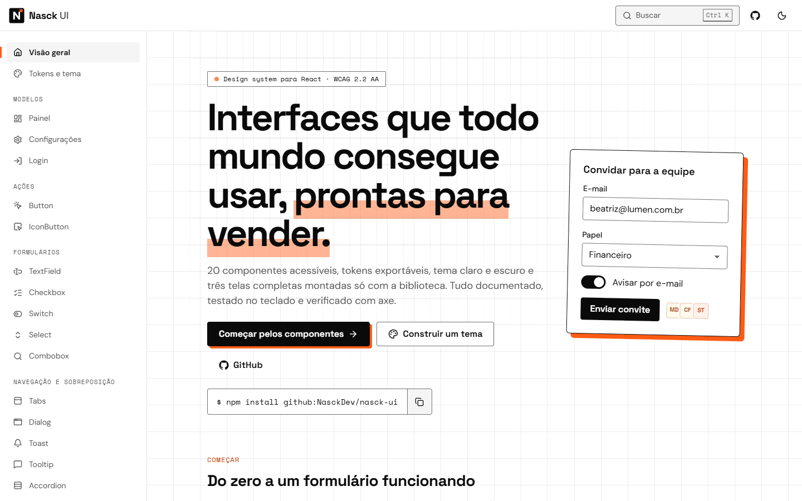
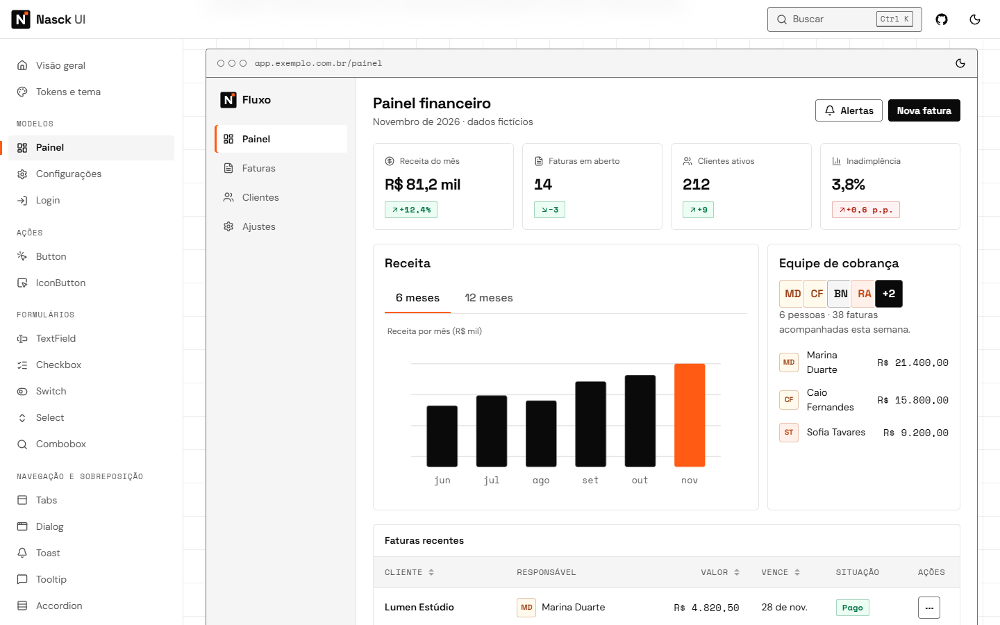
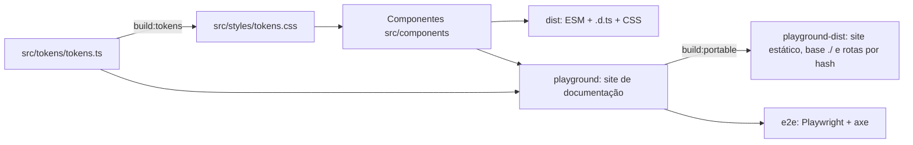

# Nasck UI · design system React acessível

[](https://github.com/NasckDev/nasck-ui/actions/workflows/ci.yml)
[](./LICENSE)


Biblioteca de **20 componentes React acessíveis**, tokens exportáveis, tema claro e escuro com contraste
calculado e um **site de documentação** com playground de props, anatomia, tabelas de teclado e ARIA,
construtor de tema e três telas completas montadas só com a biblioteca.

**Site e demo ao vivo:** <https://nasckdev.github.io/nasck-ui/> · também embutido no portfólio do autor,
em `/projetos/nasck-ui/`.



| Página de componente com playground                              | Construtor de tema (escuro)                                             |
| ---------------------------------------------------------------- | ----------------------------------------------------------------------- |
|  |        |
| **Modelo: painel**                                               | **Modelo: configurações**                                               |
|         |  |

| Celular: visão geral                                            | Celular: menu                                     | Celular: modelo painel (exemplo composto)                              |
| --------------------------------------------------------------- | ------------------------------------------------- | ---------------------------------------------------------------------- |
|  |  |  |

## O que resolve

Padrões de interface recorrentes (botões, campos, modais, abas, tabelas, menus) eram reimplementados
em cada projeto, com estados, foco e acessibilidade inconsistentes. O Nasck UI centraliza esses padrões
em um único pacote, com contratos claros, testes de teclado e axe em cada componente e documentação que
mostra o código, o teclado e o ARIA de cada um.

## Identidade

- **Tipografia:** Space Grotesk nos títulos, DM Sans no texto e Space Mono no código (auto-hospedadas
  via `@fontsource`, sem requisição externa).
- **Paleta:** monocromática de alto contraste (tinta `#0a0a0a`, papel `#ffffff`, cinzas neutros) com a
  assinatura laranja `#FF5B14` usada com parcimônia em destaques, filetes e foco.
- **Forma:** grade visível como elemento de design, cantos de 2 a 6 px e bordas de 1 px.
- Logotipo SVG próprio, tema claro e escuro, `prefers-color-scheme` respeitado.

## O site de documentação

- **Home** com vitrine viva: botões, formulário, Combobox, Table, Tabs, Avatar, Toast, Menu, Accordion
  e Pagination funcionando de verdade.
- **Cada componente** tem playground com painel de props que gera o código (e botão de copiar),
  variações e estados, anatomia interativa, tabela de teclado e ARIA, "Faça e não faça" e tabela de API.
- **Tokens e construtor de tema:** escolha a cor de destaque, receba a escala de 11 tons (OKLCH), veja
  a prévia nos dois temas, confira o contraste ao vivo e exporte o CSS.
- **Modelos:** painel, configurações e login, montados só com a biblioteca (com validação, estados de
  carregamento, confirmação de exclusão e toasts).
- **Busca Ctrl+K**, navegação lateral com ícones (`lucide-react`) e drawer no celular.
- Animações e transições discretas, todas desligadas em `prefers-reduced-motion`.

## Componentes

| Grupo                    | Componentes                                               |
| ------------------------ | --------------------------------------------------------- |
| Ações                    | Button, IconButton                                        |
| Formulários              | TextField, Checkbox, Switch, Select, Combobox             |
| Navegação e sobreposição | Tabs, Dialog, Toast, Tooltip, Accordion, Menu             |
| Dados                    | Table (ordenável e responsiva), Pagination                |
| Conteúdo e feedback      | Badge, Card, Skeleton, EmptyState, Avatar (e AvatarGroup) |

Todos têm teste de teclado e de axe. Padrões seguidos: APG para Switch, Tabs, Dialog, Tooltip,
Accordion, Menu Button e Combobox; HTML nativo (`button`, `input`, `select`, `table`) onde existe.

## Instalação

Requisitos: **React 19** (a biblioteca usa `ref` como prop, então React 18 não é suportado) e, para instalar
direto do GitHub, **Node 22.18 ou mais novo**: o script `prepare` compila a biblioteca (`dist`) na hora.

```bash
npm install github:NasckDev/nasck-ui react react-dom
npm install @fontsource-variable/space-grotesk @fontsource-variable/dm-sans @fontsource/space-mono
```

```tsx
// main.tsx: fontes e estilos, uma vez na entrada do app
import '@fontsource-variable/space-grotesk/wght.css';
import '@fontsource-variable/dm-sans/wght.css';
import '@fontsource/space-mono/latin-400.css';
import '@nasckdev/nasck-ui/styles.css';
```

```tsx
// App.tsx
import { Button, TextField, ToastProvider, useToast } from '@nasckdev/nasck-ui';

function InviteForm() {
  const { toast } = useToast();
  return (
    <form
      onSubmit={(event) => {
        event.preventDefault();
        toast({ title: 'Convite enviado', tone: 'success' });
      }}
    >
      <TextField label="E-mail" type="email" required description="Nunca compartilhamos." />
      <Button type="submit">Enviar convite</Button>
    </form>
  );
}

export function App() {
  return (
    <ToastProvider>
      <InviteForm />
    </ToastProvider>
  );
}
```

As fontes não vêm no pacote (assim você escolhe como carregá-las); os nomes estão em
`tokens.font.family`. Tema escuro: `data-theme="dark"` no `<html>`; sem o atributo, segue o sistema.
Os trechos de código das páginas de componente do site são exemplos completos (importações e dados
incluídos) e são verificados contra os tipos reais da biblioteca nos testes.

## Arquitetura



Decisões em [`docs/adr/`](./docs/adr): tokens como fonte única, HTML nativo antes de ARIA e identidade
monocromática com tema derivado do destaque.

## Desenvolvimento

```bash
npm install
npm run playground       # site em modo de desenvolvimento
npm run test:coverage    # Vitest + Testing Library + axe-core
npm run lint && npm run typecheck
npm run build            # ESM + .d.ts + CSS (+ dist/tokens.css)
npm run build:portable   # site estático em playground-dist/
npm run test:e2e         # Playwright + axe (usa a build de playground-dist)
```

No Windows, para usar o Chrome instalado nos testes E2E: `PW_CHANNEL=chrome npm run test:e2e`. Em CI o
Chromium do Playwright é instalado pelo workflow.

## Build portátil

`npm run build:portable` (alias de `build:playground`) gera `playground-dist/` com `base: './'`, nomes de
arquivo com hash e rotas por hash (`#/componentes/button`). A pasta funciona servida em qualquer subpath
(`/projetos/nasck-ui/`, `/Myportfolio/projetos/nasck-ui/`, GitHub Pages) e recarrega em qualquer rota.

## Acessibilidade

- Teclado em tudo, foco visível de duas camadas (3:1 ou mais) e `forced-colors` tratado.
- Contraste AA nos dois temas, calculado: a página de Tokens mostra a razão de cada par e os testes
  falham se algum ficar abaixo do mínimo. O construtor de tema deriva os papéis de destaque para cumprir
  o contraste com qualquer cor escolhida.
- Cor nunca é o único sinal (badges levam texto; ordenação leva texto para leitor de tela).
- Alvos de toque de 44 px, funciona de 320 a 1440 px sem rolagem horizontal e com zoom.
- axe sem violações nos testes de componente (jsdom) e nas páginas principais do site, nos dois temas
  (E2E, navegador real, com `color-contrast`).

## Qualidade e resultados

Resultado real da última execução local (Windows, Chrome instalado):

| Verificação                                             | Resultado                                                                                                                                                                                                                                                                                         |
| ------------------------------------------------------- | ------------------------------------------------------------------------------------------------------------------------------------------------------------------------------------------------------------------------------------------------------------------------------------------------- |
| Testes unitários e de componente (Vitest)               | **230 testes em 20 arquivos, todos passando**                                                                                                                                                                                                                                                     |
| Cobertura (v8)                                          | **99,31% de linhas e instruções, 97,43% de funções, 93,34% de ramos** (limite de 80% mantido; só testes, `src/test/` e `index.ts` de reexportação ficam fora da medição)                                                                                                                          |
| Trechos de código da documentação                       | todos os exemplos e todos os estados do playground são compilados contra os tipos reais da biblioteca (`snippets.test.ts`)                                                                                                                                                                        |
| E2E (Playwright + axe)                                  | **57 testes passando**: axe sem violações em 11 rotas × 2 temas e com camadas abertas (menu, combobox com e sem resultados, diálogo e paleta), sem rolagem horizontal em 360, 390, 768 e 1440 px, tabela em cartões, alvos de toque de 44 px, reload em rota interna e os fluxos dos três modelos |
| Lint (ESLint, `--max-warnings=0`), typecheck e Prettier | sem erros                                                                                                                                                                                                                                                                                         |
| Site (`build:portable`)                                 | blocos sob demanda por página e por componente; a documentação de cada componente é um chunk próprio                                                                                                                                                                                              |
| Capturas                                                | 360, 768, 1024 e 1440 px nos temas claro e escuro, em 9 páginas: sem erro de console, sem 404 e sem rolagem horizontal                                                                                                                                                                            |

Prova da instalação pelo GitHub: um projeto novo com `npm install github:NasckDev/nasck-ui#main` recebeu o
`dist` (compilado pelo `prepare`), passou no `tsc`, compilou com o Vite, renderizou no servidor
(`react-dom/server`) e, no navegador, o exemplo de "Começar" mostrou o toast ao enviar o formulário
(`docs/prints/instalacao-github-comecar.png`).

Detalhes que valem registrar:

- O `color-contrast` do axe fica desligado nos testes de componente porque o jsdom não tem layout. Ele é
  coberto pelos testes de tokens e do construtor de tema (cada par, nos dois temas) e pelo axe do E2E em
  navegador real.
- Camadas (diálogo, menu, dica, toast) usam uma pilha: Esc fecha só a de cima.
- A instalação pelo GitHub leva alguns minutos (clona, instala as dependências de desenvolvimento e
  compila); para uso contínuo, prefira publicar no registro de pacotes.

## Licença

MIT © Alexandre Diogo Nascimento
