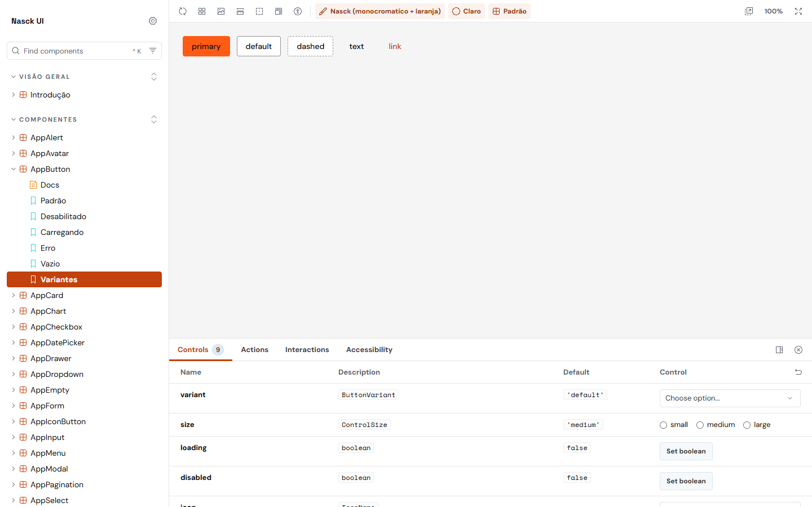
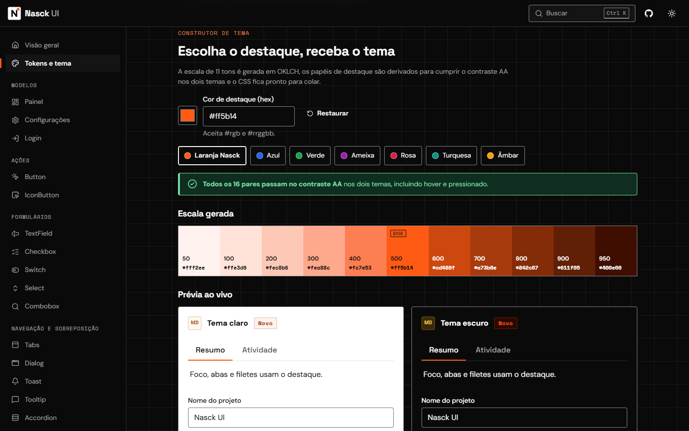

# Nasck UI · Accessible Product Interface System

[](https://github.com/NasckDev/nasck-ui/actions/workflows/ci.yml)
[](./LICENSE)


Biblioteca de componentes React acessíveis, com design tokens exportáveis, documentação de teclado
por componente e governança de qualidade (lint, tipos, testes com axe e CI).

**Demo ao vivo (playground):** <https://nasckdev.github.io/nasck-ui/> · também embutida no portfólio do
autor, em `/projetos/nasck-ui/`.

| Visão geral                                                         | Componente com estados e código                                  | Tokens com contraste (tema escuro)                                          |
| ------------------------------------------------------------------- | ---------------------------------------------------------------- | --------------------------------------------------------------------------- |
|  |  |  |

| Celular: visão geral                                            | Celular: menu                                     | Celular: exemplo composto com erro                                        |
| --------------------------------------------------------------- | ------------------------------------------------- | ------------------------------------------------------------------------- |
|  |  |  |

## Problema

Padrões de interface recorrentes (botões, campos, modais, abas, notificações) eram reimplementados
em cada projeto, com estados, foco e acessibilidade inconsistentes. O Nasck UI centraliza esses
padrões em um único pacote, com contratos claros e testados.

## Decisões

- **Tokens como fonte única** (`src/tokens/tokens.ts`): cor (tema claro e escuro), tipografia,
  espaço, raio, sombra, movimento e z-index. O script `npm run build:tokens` gera
  `src/styles/tokens.css` com custom properties `--nui-*`; a CI falha se o CSS estiver dessincronizado
  (e há um teste que confere o mesmo).
- **Temas**: `data-theme="light" | "dark"` no `<html>` ou, sem atributo, segue
  `prefers-color-scheme`.
- **Movimento**: todas as durações vêm de tokens e vão a `0ms` com `prefers-reduced-motion: reduce`.
- **Foco visível**: anel duplo (`bg` + `focus-ring`) que funciona em fundo claro e escuro, e
  `outline` em `forced-colors`.
- **HTML nativo primeiro**: `button`, `input`, `select` e `label` reais; ARIA apenas onde o HTML não
  basta (switch, tabs, dialog, tooltip).
- **Sem dependências de runtime** além de React.

## Componentes

| Componente | Padrão / semântica                                              | Teclado                         | Testes (teclado + axe) |
| ---------- | --------------------------------------------------------------- | ------------------------------- | ---------------------- |
| Button     | `button` nativo, `aria-busy` no loading                         | Enter, Espaço                   | ✅                     |
| IconButton | `aria-label` obrigatório                                        | Enter, Espaço                   | ✅                     |
| TextField  | `label` + `aria-describedby` (descrição, erro) + `aria-invalid` | nativo                          | ✅                     |
| Checkbox   | `input[type=checkbox]`, estado `indeterminate`                  | Espaço                          | ✅                     |
| Switch     | APG Switch: `role="switch"` + `aria-checked`                    | Espaço, Enter                   | ✅                     |
| Select     | `select` nativo com label, descrição e erro                     | nativo (setas, digitação)       | ✅                     |
| Tabs       | APG Tabs, ativação automática, roving tabindex                  | ←/→, Home/End                   | ✅                     |
| Dialog     | `aria-modal`, focus trap, fundo `inert`, retorno de foco        | Tab/Shift+Tab presos, Esc fecha | ✅                     |
| Toast      | região `role="status"` (`aria-live="polite"`)                   | botão de dispensar              | ✅                     |
| Tooltip    | APG Tooltip, `aria-describedby`                                 | aparece no foco, Esc fecha      | ✅                     |
| Badge      | texto (nunca só cor)                                            | —                               | ✅ (axe)               |
| Card       | `section` rotulada pelo título, nível de heading configurável   | —                               | ✅ (axe)               |
| Skeleton   | decorativo (`aria-hidden`), container usa `aria-busy`           | —                               | ✅ (axe)               |
| EmptyState | heading + descrição + ação                                      | —                               | ✅ (axe)               |

## Playground (documentação viva)

App Vite leve em `playground/`, que usa os componentes da própria biblioteca (em vez do Storybook, que
é pesado demais para este fluxo). Cada componente tem estados (padrão, desabilitado, erro,
carregando), exemplo de código copiável, tabela de teclado, notas de ARIA e tabela de props. Há também
a página de tokens (paletas clara e escura com contraste WCAG calculado, tipografia, espaço, raios,
sombras e movimento), troca de tema e um exemplo composto (tela de configurações).

- Navegação por hash (`#/componentes/button`) e `base: './'`: funciona em qualquer subpath e recarrega
  em qualquer rota. Verificado servindo a build em `/projetos/nasck-ui/`: sem 404 na rede, sem erro de
  console e sem rolagem horizontal em 390px.
- Sem fontes nem scripts de terceiros: tudo vem do próprio bundle.
- Deploy: o workflow `pages.yml` publica `playground-dist/` no GitHub Pages a cada push na `main`.

```bash
npm run playground          # servidor de desenvolvimento
npm run build:playground    # gera playground-dist/ (pasta estática portátil)
npm run preview:playground  # serve a build local
```

Para embutir em outro site, copie o conteúdo de `playground-dist/` para a pasta desejada
(por exemplo `projetos/nasck-ui/`); os caminhos dos assets são relativos.

## Instalação

```bash
npm install github:NasckDev/nasck-ui
```

```tsx
import '@nasckdev/nasck-ui/styles.css';
import { Button, TextField, ToastProvider } from '@nasckdev/nasck-ui';
import { tokens } from '@nasckdev/nasck-ui/tokens';

export function App() {
  return (
    <ToastProvider>
      <TextField label="E-mail" description="Nunca compartilhamos." />
      <Button>Salvar</Button>
    </ToastProvider>
  );
}
```

## Desenvolvimento

```bash
npm install
npm run playground       # documentação interativa
npm run test:coverage    # Vitest + Testing Library + axe-core
npm run lint && npm run typecheck
npm run build            # ESM + .d.ts + CSS (+ dist/tokens.css)
```

## Qualidade

- TypeScript `strict` + `noUncheckedIndexedAccess`, sem `any` (regra de lint).
- ESLint flat com `jsx-a11y` e `react-hooks`; `no-console` como erro.
- Testes de renderização, teclado e axe para os 14 componentes (ver tabela), mais testes de que o
  `tokens.css` está em dia com os tokens e de que cada par de cor documentado cumpre o contraste WCAG
  nos dois temas.
- **Resultado real (última execução local):** 100 testes passando; cobertura de 99,5% de linhas e
  instruções, 96,1% de ramos e 100% de funções. O limite de 80% em `vite.config.ts` foi mantido, sem
  excluir arquivos para maquiar o número (só os testes, `src/test/` e os `index.ts` de reexportação
  ficam fora da medição). O `color-contrast` do axe fica desligado nos testes porque o jsdom não tem
  layout; o contraste é coberto pelos testes de tokens e pela página de Tokens do playground.
- CI no GitHub Actions: tokens sincronizados, lint, typecheck, testes com cobertura, build da
  biblioteca e build do playground.
- Changelog e versionamento com Changesets.

Decisões de arquitetura estão em [`docs/adr/`](./docs/adr). Para contribuir, veja
[CONTRIBUTING.md](./CONTRIBUTING.md).

## Licença

MIT © Alexandre Diogo Nascimento
